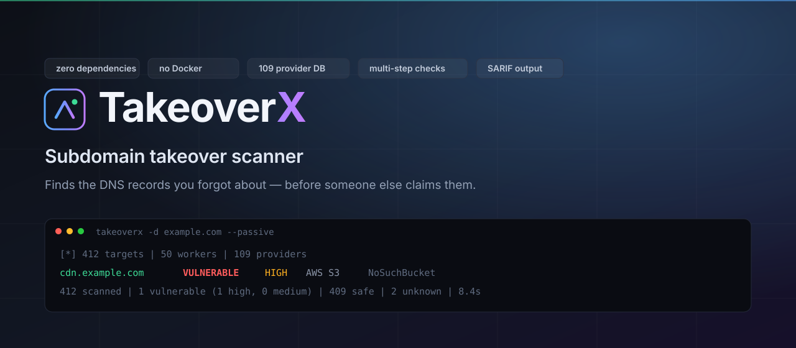

<p align="center">
  
</p>

<p align="center">
  <a href="#install"></a>
  <a href="#usage"></a>
  
  
  
  
</p>

<p align="center">
  Finds the DNS records you forgot about — before someone else claims them.
</p>

---

A subdomain points at a cloud service that has stopped claiming it. Anyone can
register the matching resource and start serving content under your domain —
stealing cookies, caching phishing pages, or quietly taking over your mail.

Most scanners stop at "this CNAME points at a provider" and call it a takeover.
It usually isn't. TakeoverX only reports a finding when it has **positive
evidence that the resource is unclaimed**.

```
$ takeoverx -d example.com --passive
[*] 412 targets | 50 workers | 109 providers
[!] cdn.example.com  AWS S3  (HIGH confidence)
      AWS S3 reports the resource is unclaimed ("NoSuchBucket")

412 scanned | 1 vulnerable (1 high, 0 medium) | 409 safe | 2 unknown | 8.4s
```

---

## Install

**One command** — picks up your architecture, no toolchain needed:

```bash
curl -fsSL https://raw.githubusercontent.com/0xStr1k3r/TakeoverX/main/install.sh | bash
```

```bash
./install.sh --check       # verify an existing install
./install.sh --force       # reinstall
./install.sh --uninstall   # remove
./install.sh --dir ~/.local/bin
```

**Or with Go:**

```bash
go install github.com/0xStr1k3r/TakeoverX@latest
```

**Or from source:**

```bash
git clone https://github.com/0xStr1k3r/TakeoverX.git
cd TakeoverX && make build
```

One direct dependency (Cobra). Pure Go — it cross-compiles with nothing but the
toolchain, and there is no container runtime anywhere in the design.

---

## Usage

Three commands cover most work.

```bash
# Everything ever issued under a domain, no wordlist needed
takeoverx -d example.com --passive

# One specific hostname
takeoverx -d cdn.example.com

# A list you already have
takeoverx -w hosts.txt
cat hosts.txt | takeoverx --stdin
```

Generate candidates from a prefix list:

```bash
takeoverx --init-wordlist                      # writes ./subdomains.txt
takeoverx -d example.com -b subdomains.txt
```

Combine sources, cap the work, slow down politely:

```bash
takeoverx -d example.com --passive -b subdomains.txt --max 500 --rate 10
```

### Options

| Flag | Default | What it does |
| --- | --- | --- |
| `-d, --domain` | — | Base domain or single hostname |
| `-w, --wordlist` | — | File of hostnames, one per line |
| `-b, --bruteforce` | — | Prefix wordlist (needs `-d`) |
| `--passive` | `false` | Discover hostnames from certificate transparency |
| `--stdin` | `false` | Read hostnames from stdin |
| `-c, --concurrent` | `50` | Concurrent workers |
| `--rate` | `0` | Requests per second (`0` = unlimited) |
| `--timeout` | `12` | Per-request timeout, seconds |
| `--repeats` | `2` | Probes that must agree before confirming |
| `--proxy` | — | Outbound proxy, e.g. `http://127.0.0.1:8080` |
| `--max` | `0` | Cap discovered hostnames |
| `--no-verify` | `false` | Report DNS matches without probing (faster, noisier) |
| `-o, --out` | `table` | `table` `json` `csv` `html` `sarif` |
| `--save` | — | Also write the report to a file |
| `--report` | — | Write a standalone HTML report |
| `-v, --verbose` | `false` | Show every hostname, not just findings |
| `--explain` | `false` | Show the verification steps behind each result |
| `--only-findings` | `false` | Drop non-findings from written reports |
| `--fail-on` | `medium` | Minimum confidence to count as a finding |
| `--exit-zero` | `false` | Always exit 0 |

---

## Why findings carry a confidence

A CNAME pointing at a cloud provider is the normal, correct state of a working
deployment. Two things that look like evidence are not:

- **The DNS pointing at a provider.** That is what a healthy site looks like.
- **A provider signature in a response header.** `Server: cloudfront` is on
  every healthy CloudFront site in the world. It identifies the provider in the
  path, not the state of the resource. AWS requires a matching certificate
  before it will attach an alternate domain name to a distribution, so a dangling
  CloudFront record is not a takeover on its own.

So the only routes to a finding are the provider's own *"this is not yours"*
response, or a target that has stopped existing for a provider whose takeover
works that way.

| Result | Meaning |
| --- | --- |
| `VULNERABLE` `HIGH` | The provider itself says the resource is unclaimed |
| `UNKNOWN` | Signals conflict, or we could not prove it either way |
| `SAFE` | The resource is claimed, or the provider has no claim path |

Two checks do most of the work:

- **Wildcard DNS veto.** A zone that answers for a randomly generated name
  makes every hostname "resolve", which destroys the evidence. Findings in such
  a zone are reported as inconclusive rather than guessed at.
- **Repeat confirmation.** Every match must reproduce on an independent probe. A
  one-off CDN or network artefact cannot become a finding.

Zones that publish wildcard DNS — `*.github.io`, `*.twilio.com`,
`*.githubusercontent.com` among them — are correctly inconclusive rather than
false positives.

Ask for the reasoning on any run:

```bash
takeoverx -d example.com --passive --explain
```

```
cdn.example.com [VULNERABLE/HIGH]
    + provider identified from DNS
    + zone has no wildcard DNS
    + provider fingerprint in response body
    + fingerprint stable across repeated probes
    + DNS answer stable on re-resolution
```

---

## Output

| Format | Use it for |
| --- | --- |
| `table` | Terminal |
| `json` | Piping into your own tooling |
| `csv` | Spreadsheet or triage sheet |
| `html` | Sharing with someone who won't use a terminal |
| `sarif` | GitHub code scanning and other CI |

The HTML report is one self-contained file — no external assets — so it still
renders offline, months later, on a machine you don't control.

```bash
takeoverx -d example.com --passive --report takeover.html
```

---

## CI

Exit codes are split so a pipeline can tell *no risk* from *the tool broke*:

| Code | Meaning |
| --- | --- |
| `0` | Nothing actionable found |
| `1` | Findings at or above `--fail-on` |
| `2` | The scan could not run |

```yaml
- name: Check for dangling DNS
  run: |
    takeoverx -d example.com --passive \
      --out sarif --save takeoverx.sarif \
      --fail-on high
```

Findings become SARIF results and show up in GitHub code scanning.

---

## Legal

TakeoverX is for authorised security testing, bug bounty work, and education.
You need **explicit written permission** from the asset owner before scanning
anything. Scanning systems you do not own or have permission to test is illegal
in most jurisdictions. The authors accept no responsibility for misuse.